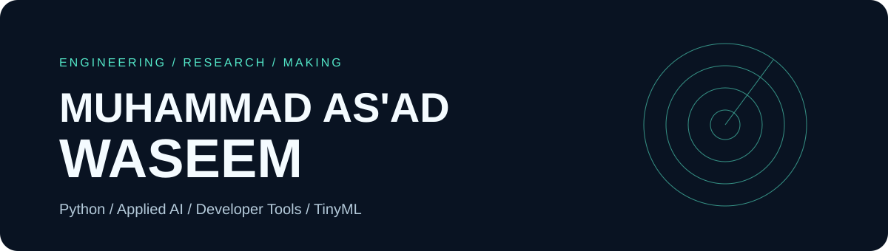

<picture>
  <source media="(prefers-color-scheme: dark)" srcset="assets/profile-banner-dark.svg">
  <source media="(prefers-color-scheme: light)" srcset="assets/profile-banner-light.svg">
  
</picture>

# PythonPortfolio — Learning archive & engineering portfolio

**Python & Applied AI Developer • Developer Tools • Automation • TinyML**

I design and build practical software across Python, AI tooling, CAD, automation, and physical systems. I have **completed an MS in Data Science**, including research into **semantic and context-aware radar gesture recognition using TinyML** for resource-constrained IoT devices.

> **Looking for my strongest work?** The original projects below represent my more recent engineering. This repository is an earlier collection of tutorials, learning exercises and experiments, preserved as part of my journey.

## Original projects — start here

| Project | Engineering problem | Implementation |
| --- | --- | --- |
| **[PolyForge](https://github.com/rx290/polyforge)** | Create editable, printable CAD from descriptions and measurements | Python library, CLI/GUI, CAD backends, dimensional validation and [tests](https://github.com/rx290/polyforge/tree/main/tests) |
| **[Cura Connect](https://github.com/rx290/cura-connect)** | Split models and add plug, dowel, snap and dovetail connectors | Geometry engine, manifold3d, Cura/QML plugin and [tests](https://github.com/rx290/cura-connect/tree/main/tests) |
| **[PrintTally](https://github.com/rx290/printtally)** | Estimate full 3D-print cost beyond filament | Shared Python costing engine, Cura and Orca/Prusa adapters, [tests](https://github.com/rx290/printtally/tree/main/tests) |
| **[GrantCompass](https://github.com/rx290/grant-compass)** | Discover and score funded research/study opportunities | Python CLI, scoring and reporting, [tests](https://github.com/rx290/grant-compass/tree/master/tests) |

## Research — radar signals to contextual intent

**MS Data Science, completed.** My thesis explored radar-gesture/signal recognition and semantic intent mapping on memory-constrained TinyML/IoT devices.

**Research flow:** Radar I/Q input → compact CNN classification → 8-bit quantization and MCU constraints → application-context-aware actions.

The work explored four heterogeneous radar gesture datasets and compact CNN designs across multiple resolutions. It was research and prototyping rather than a claim of a deployed commercial product.

## What this repository contains

Python fundamentals, algorithms, data structures, APIs, scripting, web frameworks, testing, data analysis, and exploratory code. Many files are learning exercises, **not production-grade applications**.

- [**Original full README and directory tree**](LEARNING_ARCHIVE.md) — historical content preserved
- [Learning notes and roadmap](About.md)
- [Method glossary](Method%20Glossary.md)
- [Recruiter-focused profile README draft](PROFILE_README.md)

**For recruiters:** Evaluate the original engineering projects linked above rather than forks or tutorial exercises.

[Explore my repositories](https://github.com/rx290?tab=repositories)
